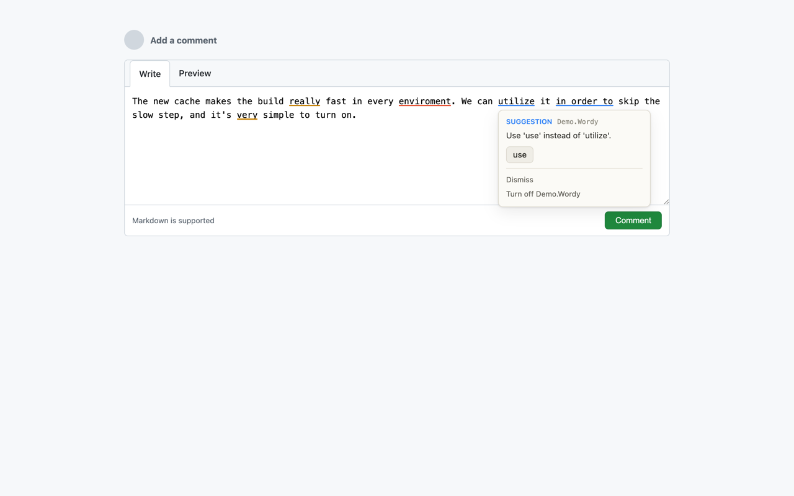
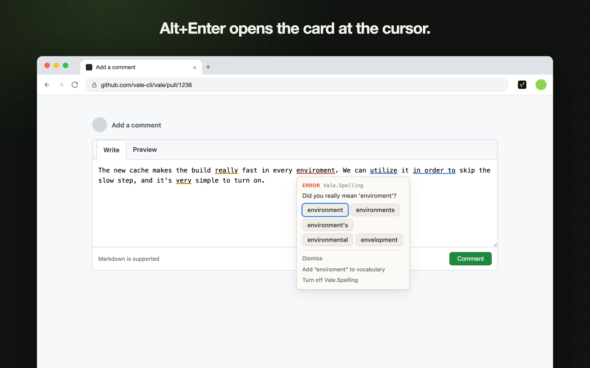

<div align="center">
  <a href="https://vale.sh">
    <picture>
      <source media="(prefers-color-scheme: dark)" srcset="https://vale.sh/brand/vale-logo-white.svg">
      
    </picture>
  </a>
  <h3>Your style guide, as you type.</h3>
  <p>
    Vale's browser extension checks what you write on the web, from a pull-request<br>
    description to an email, against your Vale configuration. Nothing leaves your browser.
  </p>
  <p>
    <a href="https://vale.sh/#browser">Install</a> ·
    <a href="https://vale.sh/privacy/extension">Privacy</a> ·
    <a href="https://docs.vale.sh">Vale docs</a> ·
    <a href="https://vale.sh/explorer">Package Explorer</a> ·
    <a href="https://discord.gg/NTX6Xggryj">Discord</a>
  </p>
</div>

<p align="center">
  
</p>

> [!NOTE]
> This extension was built with a $10,000 grant from
> [FLOSS/fund](https://floss.fund/blog/second-tranche-2025-anniversary/), in its
> second 2025 tranche. Thank you.

Alerts are underlined as you type, in text areas, inputs, and rich editors,
on GitHub, GitLab, and any other site you turn it on for. Each one opens a
card with its reason and its fix. Vale's WebAssembly build runs inside the
extension and reads your configuration from its own storage, so your text is
never sent anywhere.

## Install

The extension is in review for the Chrome Web Store, with Edge and Firefox to
follow; [vale.sh](https://vale.sh/#browser) links each listing as it goes live.
Until then, build it from source: see [Development](#development).

## Using it

Click a mark, or press <kbd>Alt</kbd>+<kbd>Enter</kbd> with the cursor in one,
for its card: the message, its fixes, and three ways to deal with it.

- **Dismiss** hides that one alert, where it stands.
- **Turn off** stops the rule everywhere.
- **Add to vocabulary** accepts a word the spelling rules flagged.

A badge in the field's corner, Vale's mark, says how its last check went: the
mark alone when there's nothing to fix, the number of alerts beside it when
there is, or `!` when the profile couldn't be loaded. Click a count to open
the first alert's card.

| Key | In a field |
| --- | --- |
| <kbd>Alt</kbd>+<kbd>Enter</kbd> | Open the card at the cursor; the arrows walk it and <kbd>Enter</kbd> applies |
| <kbd>Alt</kbd>+<kbd>Shift</kbd>+<kbd>Enter</kbd> | Apply the first fix without opening the card |
| <kbd>Esc</kbd> | Close the card and put the cursor back |
| <kbd>Alt</kbd>+<kbd>Shift</kbd>+<kbd>V</kbd> | Check the focused field, when checking as you type is off |

Everything you've said from a card is listed on the options page's **Yours**
tab, where any of it can be undone.

It's tested in plain text areas and inputs, in fields inside frames and shadow
DOM, and in ProseMirror, TipTap, Lexical, Slate, Quill, and CKEditor.



## Configuration

One profile, on every site that's on: a `.vale.ini`, the packages it names
(synced from the [package library](https://vale.sh/explorer) or uploaded as a
`.zip`, so a house style works anywhere), and the format each site's editors
are written in. GitHub and GitLab are on to start.

Two modes, in the popup:

- **Check as you type**: underlines update as you edit.
- **On demand**: nothing happens while you type, so another checker can have
  the field. Check the focused field from the popup or with
  `Alt+Shift+V`.

<p align="center"></p>

The options page holds the profile: the configuration, its packages, and the
sites linting is on for.


## Browsers

| Browser                    | Build                 | Notes                                            |
| -------------------------- | --------------------- | ------------------------------------------------ |
| Chrome, Edge, Brave, Opera | `.output/chrome-mv3`  | Chromium 116 or later.                           |
| Firefox                    | `.output/firefox-mv3` | Firefox 128 or later; signed through AMO to keep. |

## Permissions

| Permission                  | Why                                                                                      |
| --------------------------- | ---------------------------------------------------------------------------------------- |
| `storage`, `unlimitedStorage` | Your configuration and packages. A package is a few megabytes.                        |
| `activeTab`                 | The popup reads the current tab's URL to turn the site on or off.                       |
| `github.com`, `raw.githubusercontent.com` | Library packages.                                                      |
| A content script on every site | Finds the field you're typing in. It does nothing on a site that isn't turned on.    |

A package hosted anywhere else asks for its origin the first time it is synced.

## Formats

Markdown, AsciiDoc, reStructuredText, HTML, and plain text are checked in the
browser; Vale reads all five natively. Each site has a format, Markdown for
GitHub and GitLab, set on the options page. In GitHub's and GitLab's file
editors the file's extension decides instead, so a `.rst` file is checked as
reStructuredText. See [the WebAssembly build](https://docs.vale.sh/topics/wasm)
for what the module supports.

## Development

This is a [WXT](https://wxt.dev) project with Svelte 5.

```bash
task install        # dependencies
task dev            # Chromium build with reload, in .output/chrome-mv3-dev
task dev-firefox
task build          # production builds
task build-firefox
task zip            # store archives
task test           # unit tests and type checks
task e2e            # the built extension in Chromium: the card, the options page, and fixes in 11 editors
                    # VALE_E2E_BROWSER=/path/to/brave task e2e runs it in another Chromium build
task wasm           # refresh public/vale.wasm from ../vale, or: task wasm -- vale_3.26.0_wasm.tar.gz
```

Load `.output/chrome-mv3` as an unpacked extension at `chrome://extensions`
(Developer mode), or `.output/firefox-mv3` as a temporary add-on at
`about:debugging#/runtime/this-firefox`.

The module and its loader come from a Vale release's `vale_<version>_wasm.tar.gz`,
or from a checkout's `make wasm`.

## License

MIT. Questions and bug reports go to the
[issue tracker](https://github.com/vale-cli/vale-web/issues) or
[Discord](https://discord.gg/NTX6Xggryj).
