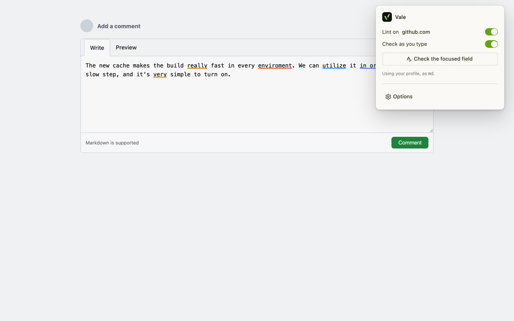
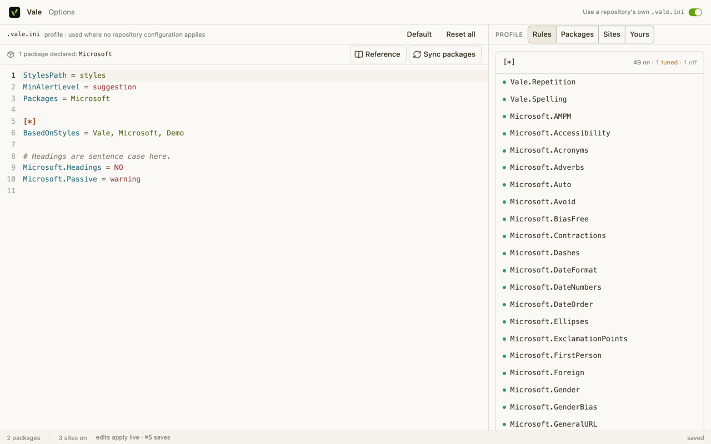

# Vale for the web

> [!NOTE]
> This extension was built with a $10,000 grant from
> [FLOSS/fund](https://floss.fund/blog/second-tranche-2025-anniversary/), in its
> second 2025 tranche. Thank you.

Vale's browser extension brings your style guide to the fields you write in:
GitHub and GitLab comments, pull-request descriptions, and the web editor, and
any other site you turn it on for. Alerts are underlined as you type, and a
popover on each one explains it and applies the fix.

Linting runs entirely in your browser. The extension carries Vale's
WebAssembly build and reads your configuration and packages from its own
storage; nothing is sent anywhere.


## How it decides what to check

One profile, on every site that's on: a `.vale.ini`, the packages it names
(synced from the [package library](https://vale.sh/explorer) or uploaded as a
`.zip`, so a house style works anywhere), and the format each site's editors
are written in. GitHub and GitLab are on to start.

Two modes, in the popup:

- **Check as you type**: underlines update as you edit.
- **On demand**: nothing happens while you type, so another checker can have
  the field. Check the focused field from the popup or with
  `Alt+Shift+V`.

<p align="center"></p>

The options page holds the profile: the configuration, its packages, and the
sites linting is on for.



## Browsers

| Browser                    | Build                 | Notes                                            |
| -------------------------- | --------------------- | ------------------------------------------------ |
| Chrome, Edge, Brave, Opera | `.output/chrome-mv3`  | Chromium 116 or later.                           |
| Firefox                    | `.output/firefox-mv3` | Firefox 128 or later; signed through AMO to keep. |

## Permissions

| Permission                  | Why                                                                                      |
| --------------------------- | ---------------------------------------------------------------------------------------- |
| `storage`, `unlimitedStorage` | Your configuration and packages. A package is a few megabytes.                        |
| `activeTab`                 | The popup reads the current tab's URL to turn the site on or off.                       |
| `github.com`, `raw.githubusercontent.com` | Library packages.                                                      |
| A content script on every site | Finds the field you're typing in. It does nothing on a site that isn't turned on.    |

A package hosted anywhere else asks for its origin the first time it is synced.

## Formats

Markdown, AsciiDoc, reStructuredText, HTML, and plain text are checked in the
browser; Vale reads all five natively. Each site has a format, Markdown for
GitHub and GitLab, set on the options page. In GitHub's and GitLab's file
editors the file's extension decides instead, so a `.rst` file is checked as
reStructuredText. See [the WebAssembly build](https://docs.vale.sh/topics/wasm)
for what the module supports.

## Development

This is a [WXT](https://wxt.dev) project with Svelte 5.

```bash
task install        # dependencies
task dev            # Chromium build with reload, in .output/chrome-mv3-dev
task dev-firefox
task build          # production builds
task build-firefox
task zip            # store archives
task test           # unit tests and type checks
task e2e            # the built extension in Chromium: the card, the options page, and fixes in 11 editors
                    # VALE_E2E_BROWSER=/path/to/brave task e2e runs it in another Chromium build
task wasm           # refresh public/vale.wasm from ../vale, or: task wasm -- vale_3.26.0_wasm.tar.gz
```

Load `.output/chrome-mv3` as an unpacked extension at `chrome://extensions`
(Developer mode), or `.output/firefox-mv3` as a temporary add-on at
`about:debugging#/runtime/this-firefox`.

The module and its loader come from a Vale release's `vale_<version>_wasm.tar.gz`,
or from a checkout's `make wasm`.
